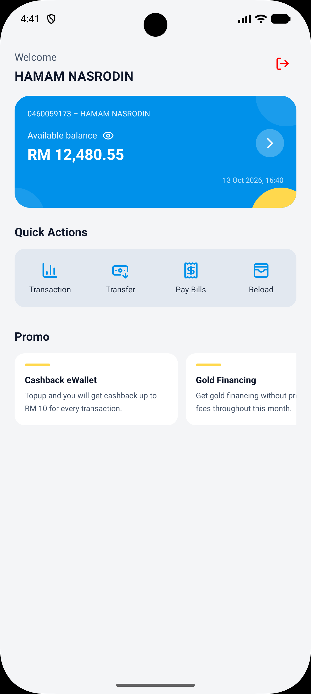
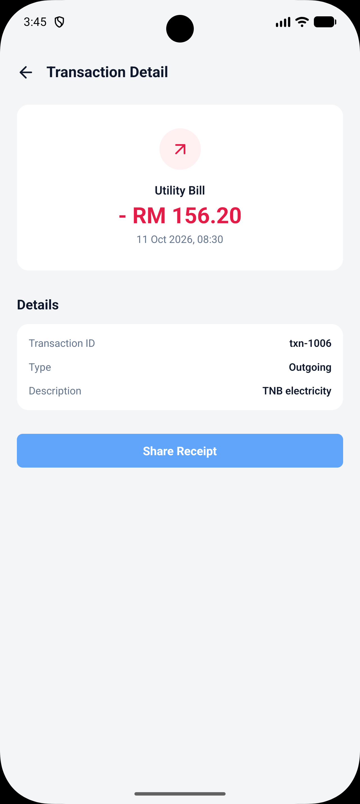

# Aeon Bank (PoC)

A React Native + TypeScript proof of concept for a mobile banking app, built to show a
clean, production-shaped project structure.

## What's included

| Screen              | Behaviour                                                                                               |
| ------------------- | ------------------------------------------------------------------------------------------------------- |
| Dashboard           | Greeting, account card with a balance visibility toggle, quick actions, promo carousel, pull-to-refresh |
| Transaction history | Newest-first list, search across title and description, All/Incoming/Outgoing filter, pull-to-refresh   |
| Transaction detail  | Full breakdown of the selected transaction plus a native share sheet                                    |

Every fetching screen handles the whole request lifecycle — a loading indicator, an
error state with retry, and an empty state where a list can legitimately come back
empty. Positive amounts render green and negative amounts red, and the mock API adds
artificial latency so those states are actually observable while developing.

## Screenshots

| Dashboard                                                             | Transaction history                                                                       | Transaction detail                                                                      |
| --------------------------------------------------------------------- | ----------------------------------------------------------------------------------------- | --------------------------------------------------------------------------------------- |
|  |  |  |

## Tech stack

| Concern     | Choice                                          |
| ----------- | ----------------------------------------------- |
| Runtime     | React Native 0.87 (New Architecture) + React 19 |
| Language    | TypeScript (strict)                             |
| Navigation  | React Navigation 7 (native stack)               |
| State       | Zustand 5                                       |
| Styling     | NativeWind 4 (Tailwind CSS 3)                   |
| Icons       | lucide-react-native (react-native-svg)          |
| Tests       | Jest + `@react-native/jest-preset`              |
| Package mgr | Bun (`bun.lock` is the committed lockfile)      |

## Requirements

- Node.js >= 22.11
- [Bun](https://bun.sh) for dependency management
- Xcode + CocoaPods (iOS) and/or the Android SDK (Android) — see the
  [environment setup guide](https://reactnative.dev/docs/set-up-your-environment)

## Getting started

```sh
# 1. Install JavaScript dependencies
bun install

# 2. Install iOS native dependencies (first clone, or after changing native deps)
cd ios && bundle install && bundle exec pod install && cd ..

# 3. Start Metro
bun start

# 4. Build and run (in a second terminal)
bun run ios
# or
bun run android
```

## Scripts

| Script                    | Description                   |
| ------------------------- | ----------------------------- |
| `bun start`               | Start the Metro dev server    |
| `bun run ios`             | Build and run the iOS app     |
| `bun run android`         | Build and run the Android app |
| `bun run lint`            | Run ESLint over the project   |
| `bun run test`            | Run the Jest test suite       |
| `bunx tsc --noEmit`       | Type-check the project        |
| `bunx prettier --check .` | Check formatting              |

Before pushing, the three gates are `tsc --noEmit`, `bun run lint` and `bun run test`.

## Project structure

```text
├── App.tsx                         Root component: providers + navigation container
├── index.js                        React Native entry point
├── global.css                      Tailwind entry point compiled by NativeWind
├── app.json                        App name and display config
├── babel.config.js                 React Native preset + the NativeWind transform
├── metro.config.js                 Metro wrapped with withNativeWind
├── tailwind.config.js              Content globs, design tokens, NativeWind preset
├── nativewind-env.d.ts             NativeWind and CSS ambient type declarations
├── jest.config.js                  Jest preset, CSS stub, transforms
├── .eslintrc.js                    ESLint, extending @react-native
├── .prettierrc.js                  Prettier formatting rules
├── .prettierignore                 Keeps vendored native output out of formatting
├── screenshot/                     Screenshots used by this README
└── src
    ├── __mocks__/styleMock.js      Stubs the CSS import for Jest
    ├── __tests__/                  Unit tests
    │   ├── CurrencyFormatter.test.ts
    │   ├── shareReceipt.test.ts
    │   ├── TransactionDetailScreen.test.tsx
    │   ├── TransactionListItem.test.tsx
    │   ├── transactions.test.ts
    │   ├── useDashboardStore.test.ts
    │   └── useTransactionStore.test.ts
    ├── api/                        Data access: one repository per entity
    │   ├── MockPromoRepository.ts
    │   ├── MockTransactionRepository.ts
    │   ├── MockUserRepository.ts
    │   └── simulateRequest.ts      Mocks network latency
    ├── components/                 Reusable, presentation-only components
    │   ├── AccountCard.tsx
    │   ├── DashboardHeader.tsx
    │   ├── DetailRow.tsx           Label/value pair inside a detail card
    │   ├── EmptyState.tsx          "Nothing here" placeholder
    │   ├── ErrorState.tsx          Failure message + retry
    │   ├── FilterChips.tsx         Generic single-select chip row
    │   ├── LoadingState.tsx
    │   ├── PromoSection.tsx
    │   ├── PullToRefresh.tsx       Shared RefreshControl factory
    │   ├── QuickActions.tsx
    │   ├── Screen.tsx              Safe-area aware screen container
    │   ├── ScreenHeader.tsx        Back button + screen title
    │   ├── SearchField.tsx         Text input with search icon, clear button
    │   ├── SectionHeading.tsx
    │   └── TransactionListItem.tsx
    ├── navigation/                 Navigator, route names and typed route params
    │   ├── RootNavigator.tsx
    │   ├── ScreenName.tsx
    │   └── types.ts
    ├── screens/
    │   ├── DashboardScreen/        Screen composition + screen-only data
    │   │   ├── data.tsx            Quick actions paired with their lucide icons
    │   │   └── index.tsx
    │   ├── TransactionDetailScreen/
    │   │   └── index.tsx
    │   └── TransactionScreen/
    │       └── index.tsx
    ├── store/                      Zustand stores
    │   ├── requestState.ts         Shared request-lifecycle defaults
    │   ├── useDashboardStore.tsx
    │   └── useTransactionStore.tsx
    ├── theme/
    │   └── colors.tsx              Raw values for native-only APIs
    ├── types/                      Domain models
    │   ├── dashboard.ts
    │   └── transaction.ts
    └── utils/                      Shared helpers
        ├── CurrencyFormatter.ts    Formats amounts for display
        ├── ShareReceipt.ts         Wraps Share.share(), reports the outcome
        ├── ShowToast.ts            Thin wrapper over react-native-toast-message
        └── TransactionUtil.ts      Pure search / filter / sort logic
```

## How the libraries are wired

### Navigation

`src/navigation/ScreenName.tsx` is the single source of truth for route names and
`src/navigation/types.ts` maps them to their params, so a typo in a route name is a
compile error rather than a runtime crash. A single root native stack renders the
screens (`src/screens/*`), each in its own folder with a default-exported component;
screens receive their navigation types from `NativeStackScreenProps`.

### State

Stores live in `src/store` and are created with Zustand's `create`.
`useDashboardStore` owns everything the dashboard renders — the fetched account and
promos, their request status (`isLoading`, `isError`, `isSuccess`, `errorMessage`) and
the balance visibility toggle:

```ts
const { accountSummary, promos, isLoading, fetchUser, fetchPromos } =
  useDashboardStore(state => state);
```

### Data access

`src/api` holds one repository per entity, each a class with async methods, so screens
never talk to a data source directly:

```ts
const account = await userRepository.getUser();
```

The mock implementations return canned responses after `simulateRequest`'s artificial
latency, which is what makes the loading state visible in development. Replacing them
with the real API means implementing the same methods with `fetch` — the store and the
screens stay untouched.

The store owns the request lifecycle: `fetchUser` / `fetchPromos` set `isLoading`,
then either store the data and set `isSuccess`, or record `errorMessage` and set
`isError` before rethrowing so callers can react.

The dashboard runs both on mount, and pull-to-refresh re-runs them without clearing
what is already on screen:

```ts
const refreshDashboard = useCallback(
  () => Promise.all([fetchUser(), fetchPromos()]),
  [fetchUser, fetchPromos],
);
```

The transaction list applies the same shape to its single fetch. The store already
records the failure, so the screen's own `catch` only stops the rejection escaping the
effect — a failed refresh keeps the rows that are already on screen:

```ts
const loadTransactions = useCallback(async () => {
  try {
    await fetchTransactions();
  } catch {}
}, [fetchTransactions]);
```

Pull-to-refresh lives in the shared `Screen` container (`refreshing` + `onRefresh`), so
any scrollable screen gets it for free; screens that own their scroller, such as the
transaction list, attach the same control to the `FlatList` instead.

### Transactions

`src/screens/TransactionScreen` renders the list, but it holds none of the logic.
Searching, filtering and ordering are pure functions in `src/utils/TransactionUtil.ts`,
so they are unit-testable without rendering anything:

```ts
sortTransactionsByDateDesc(
  filterTransactions(transactions, { search, direction }),
);
```

`filterTransactions` matches the search term against a transaction's title and
description (case-insensitive, trimmed) and applies the direction filter, where
`getTransactionDirection` derives incoming vs outgoing from the sign of the amount.
`sortTransactionsByDateDesc` returns a new array rather than sorting in place, so the
store's state is never mutated from a render.

The screen keeps two local pieces of state — the search term and the selected chip —
and derives the visible rows from them with `useMemo`. Search and chips live in the
list's `ListHeaderComponent`, and the pull-to-refresh control is attached directly to
the `FlatList`, which keeps the results scrollable and the input focus stable:

```tsx
refreshControl={PullToRefresh(isLoading, loadTransactions)}
```

`PullToRefresh` returns a `RefreshControl` element instead of being a component. On
Android, `ScrollView` clones the `refreshControl` element and passes the scroll view as
its children, so a wrapper component would silently drop the list.

### Transaction detail

The detail screen reads the row the user tapped from the store rather than from route
params, so the route stays a plain `undefined` param and nothing needs serialising:

```ts
selectTransaction: (transaction: Transaction) => void;
```

Tapping a row writes to the store and then navigates, and
`src/screens/TransactionDetailScreen` reads it back:

```tsx
const openTransactionDetail = useCallback(
  (transaction: Transaction) => {
    selectTransaction(transaction);
    navigation.navigate(ScreenName.TransactionDetailScreen);
  },
  [navigation, selectTransaction],
);
```

`TransactionListItem` stays presentational — it receives an `onPress` callback and never
knows about navigation — and the screen renders a fallback `EmptyState` if it is opened
without a selection, so a future entry point cannot land on a blank screen.

### Sharing

`src/utils/ShareReceipt.ts` wraps React Native's `Share.share()` so screens never touch
the native API or its result handling:

```ts
await shareReceipt(receiptText);
```

It reports the outcome as a toast — the sheet completing, being dismissed, or throwing —
which keeps that branching out of the screen. The screen only assembles the receipt
text from the selected transaction, and `Share.share()` gives the platform share sheet
for free on both iOS and Android.

### Styling

NativeWind compiles `global.css` through Tailwind into React Native styles, which is
what allows components to use the `className` prop. Three files make that work:

- `tailwind.config.js` — content globs (`App.tsx`, `src/**/*`), the design tokens
  (`brand`, `sun`, `leaf`, `surface`) and the NativeWind preset
- `babel.config.js` — adds the `nativewind/babel` preset, which also registers the
  Reanimated/Worklets transform used by `react-native-reanimated`
- `metro.config.js` — wraps the default Metro config with `withNativeWind`

Icons come from `lucide-react-native` (drawn with `react-native-svg`). The dashboard's
quick actions pair each action with its icon element in
`src/screens/DashboardScreen/data.tsx`, so the icon sits next to the action it
describes rather than in a separate lookup map.

## Conventions

- **Strict TypeScript, no `any`.** Domain models live in `src/types` and are the only
  definition of each shape; screens, stores and components import them instead of
  re-declaring inline types, so a change to a model surfaces as a compile error.
- **Screens compose, components render.** A screen owns the fetching and the layout; the
  pieces in `src/components` take props and callbacks only. `TransactionListItem`
  receives an `onPress` and knows nothing about navigation, which is what makes it
  renderable in a test without a router.
- **Logic lives outside the render.** Anything with a decision in it — filtering,
  sorting, formatting, direction — is a pure function in `src/utils`, covered by tests
  that never mount a component.
- **One owner per piece of state.** Stores hold fetched data and cross-screen selections;
  purely local UI state (the search term, the active chip) stays in the screen that uses
  it.
- **Accessibility is part of the component.** Buttons in `src/components` declare an
  `accessibilityRole` and a label, and each transaction row summarises its own contents
  for screen readers.

## Testing

```sh
bun run test
```

31 tests across 7 suites. Logic is covered without rendering anything:

- `src/__tests__/transactions.test.ts` — direction detection, case-insensitive search
  across title and description, direction filtering, newest-first ordering and the fact
  that the helpers never mutate their input
- `src/__tests__/CurrencyFormatter.test.ts` — sign handling, thousands grouping and the
  zero boundary
- `src/__tests__/shareReceipt.test.ts` — the shared, dismissed and failed outcomes
- `src/__tests__/useDashboardStore.test.ts` and
  `src/__tests__/useTransactionStore.test.ts` — the fetch lifecycle (loading flag,
  resolved data, recorded error) plus the balance and selection state

The two component suites render with `react-test-renderer`:

- `src/__tests__/TransactionListItem.test.tsx` — the row's text, its accessibility label and
  the fact that a tap hands the transaction back to the caller
- `src/__tests__/TransactionDetailScreen.test.tsx` — the empty selection fallback, the
  incoming/outgoing variants and the receipt payload built for sharing

Jest is configured in `jest.config.js`: `\.css$` maps to a stub, the transform allow-list
covers the ESM packages used by React Navigation and NativeWind, and `.mjs` is added to
`transform` because ESM-only packages such as `lucide-react-native` resolve to it under
the `react-native` export condition.

## Future improvements

- **Real API layer.** `src/api` already isolates data access behind one class per entity,
  so replacing a `Mock*Repository` with an HTTP implementation of the same methods leaves
  the stores and screens untouched. Retries, auth headers and response validation belong
  there too.
- **Money as minor units.** Amounts are `number` today, which is fine for a PoC but
  should become integer cents before real balances are involved.
- **Paginated history.** The list loads every transaction at once; a real account needs
  cursor pagination with `onEndReached` and a footer spinner.
- **Group the list by date.** Month and day headers instead of a timestamp on every row.
- **Auth and session handling.** There is no login, token storage, or 401 handling yet.
- **Error boundary.** A top-level boundary so an unexpected render error cannot blank the
  app.
- **Accessibility sweep.** The share button on the detail screen is identified by its
  visible text only; give every interactive element an explicit role and label and verify
  the flows with a screen reader.
- **Notification pattern.** Replace the toast calls with a single app-level notification
  service once real failures need to be retried or logged.
- **CI.** Run `tsc --noEmit`, ESLint, Prettier and Jest on every push.
- **Wider test surface.** Move the component suites to
  `@testing-library/react-native` for user-centric queries, and cover the screens
  end-to-end with Maestro or Detox.
- **Dark mode and i18n.** The colour tokens live in `tailwind.config.js` and copy is
  inline, so both are additive rather than structural changes.

## Learn more

- [React Native docs](https://reactnative.dev/docs/getting-started)
- [React Navigation docs](https://reactnavigation.org/docs/getting-started)
- [Zustand docs](https://zustand.docs.pmnd.rs/getting-started/introduction)
- [NativeWind docs](https://www.nativewind.dev/getting-started/react-native)
